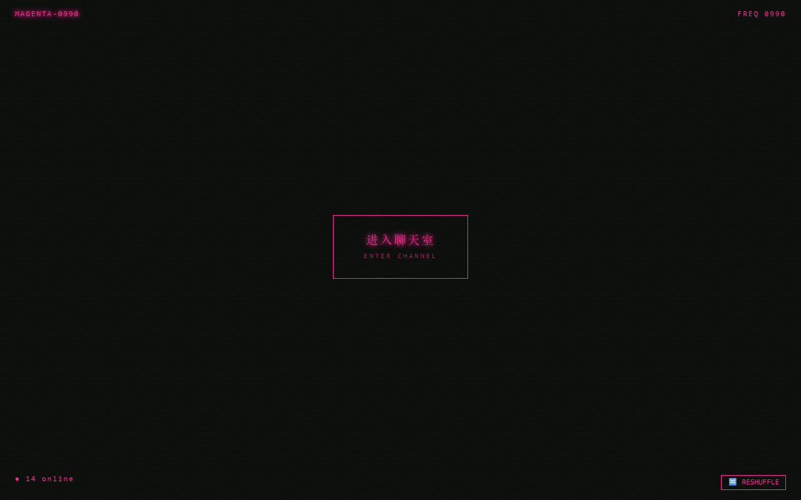

# kuoluosaigai

> 谐音"阔落塞该"。一个终端风的概念首页 + 真匿名聊天室，致敬无头骑士异闻录里的 Dollars 频道。



打开站点，像在接入一个匿名频道：开机序列逐行打印日志、光标闪烁，按回车或点击屏幕，一道扫描线自上而下扫过，露出黑底扫描线的主界面。随机分到一个频道（绿/青/品红/琥珀），代号 + 频率显示在顶栏。点中央脉动的「进入聊天室」，服务端即时给你分配一个 `ANON-XXXX` 匿名代号，进入全屏终端聊天——消息即焚、无需登录、在线人数实时可见。还能开一个只有你知道 ID 的私房把朋友叫来：房间就是一个 6 位短码，服务器不存任何聊天记录，记忆只在在场者的浏览器之间流转。

## 特性

- **开机序列 + 接入动画**：打字机式终端日志 + 闪烁光标；Enter 键 / 点击任意处触发，自上而下扫描线 wipe 露出主界面（三态相位 `boot → wiping → shell`，reduced-motion 直达终态）
- **4 个随机频道**：SETSUBUN(绿) / NEBULA(青) / MAGENTA(品红) / AMBER(琥珀)，sessionStorage 持久，刷新不跳变；状态栏 🔄 RESHUFFLE 一键换频，主色经 CSS 变量 + Ant Design ConfigProvider 全局注入
- **真匿名聊天室**：Node + WebSocket 自托管后端，随机昵称（不可自选）、频道徽章、纯文本 + 限速(10/min) + 长度截断(280)、真实在线计数、断线退避重连
- **多聊天室**：房间 = 6 位 `[a-z0-9]` 短码 ID，除此之外零元数据。四个公共房承接抽签落地；抽屉里可新建私房（复制 ID 邀友）、按 ID 加入（未知 ID 拒绝——碰运气需要运气）、从列表移除。服务器没有房间目录、不可搜索；聊天记录**不落服务器**——记忆存在在场者的浏览器里，新人进入向在场者索取并多数派合并，最后一人离开，这段共同记忆就此消亡。护栏：100 人/房、历史 200 条/份、浏览器 LRU 20 房×500 条、输错 ID 10 次/分、建房 5 间/分、切房 20 次/分。站内 RULES 页向用户讲明全部规则
- **个人 AI Bot（BOT DECK）**：顶栏 BOT 入口开控制台——自建「人格卡」（名字/性格/话痨度/温度等），每个 bot 以匿名参与者连进你指定的房间，按拟人节奏接话与发起闲聊（概率分档、思考/打字延迟、小时预算、rate 限频退避、随机 AFK）。AI 服务商自配：DeepSeek/Kimi/OpenRouter 预设或任意 OpenAI 兼容 baseUrl，**API key 只存你本机浏览器（localStorage），页面代码直连服务商**，聊天服务器不经手。同机多标签用租约心跳互斥，保证同一 bot 只在一处跑；**关标签页即停**：dispose 停全部 runner、释放租约、冲刷 token 用量。同房多 bot 按「家族」协调（对话预算共享视角、房间级闲置发起调度）。**P4 拟人化**：上下文压成 transcript 单条、注入公开贴吧真实短句 few-shot，按人似分布抽目标字数，允许模型选择沉默，一条输出可拆 2–4 条间隔发送；静默窗内被点名会进入「迷糊层」（更慢、更短、不拆段）
- **终端风 favicon**：绿框 `K` + 扫描线 SVG 矢量图标
- **降级**：尊重 `prefers-reduced-motion`，关动效直接显示终态；WS 端点未配置时聊天室显示离线文案不崩；http 部署（非安全上下文）没有 `crypto.randomUUID`，BOT DECK 的标签页标识自动降级为本机生成的时间戳+随机串——跨标签互斥只需同机唯一，不受影响

## 技术栈

| 层 | 技术 |
|---|---|
| 前端 | Vue 3 + Ant Design Vue（魔改主题）+ Vitest。自定义创意做英雄区，Ant Design 做结构化面板 |
| 后端 | Node.js + [`ws`](https://www.npmjs.com/package/ws)，无框架、无数据库；落盘只有房间 ID 注册表 `server/data/rooms.log`（append-only）与设备配对表 `server/data/devices.json`（P3a），消息内容永不落盘 |
| 传输 | WebSocket，JSON 文本帧 |
| bot 核心包 | [`packages/bot-core`](packages/bot-core/)（`kuoluosaigai-bot-core`）：浏览器 BOT DECK 面板与 `saigai-bot` 常驻 daemon 共用的**宿主无关核心**——纯 ESM、零 Vue/DOM/localStorage，浏览器与 Node 两侧只是注入的宿主原语不同 |

生产默认统一服务：一个 Node 进程同端口托管 `dist/` 静态与 WebSocket（见下方部署）。多房间协议与 P2P 记忆的现行权威文档：[`docs/superpowers/specs/2026-10-20-kuoluosaigai-multi-room-design.md`](docs/superpowers/specs/2026-10-20-kuoluosaigai-multi-room-design.md)；[`docs/chatroom-architecture.md`](docs/chatroom-architecture.md) 为 v2 时期的历史技术文档（含大量「为什么这么设计」的问答，但单房间设定已过时）。

## 本地开发

```bash
npm install                # workspaces 会同时装好 server/ 子包
npm run dev                # 前端 http://localhost:8080（被占用会自增端口）

# 后端聊天服务（另开终端，换个端口避免打架）
PORT=8081 npm start        # 未 build 时静态部分回 502 提示，不影响 ws；测试期可用 KUO_ROOMS_FILE=/tmp/rooms.log 隔离注册表

# 让 dev 前端连到本地后端：项目根新建 .env.local
echo "VUE_APP_WS_URL=ws://localhost:8081" > .env.local
```

打开两个浏览器窗口访问前端，各自经开机序列 → 进入聊天室，即可看到对方加入 / 发言 / 在线数变化；一边 `[+ NEW]` 建个私房、把 6 位 ID 粘给另一边加入，再切回公共房切回来——历史记录仍在（P2P 记忆）。

```bash
npm test               # 前端 + 后端全量（现 388 个：客户端 349 + 服务端 39，含 2 个纯 Node e2e）
npm run build          # 生产构建，产物在 dist/
```

> 根目录直接 `npm test` 会同时跑前端 + 后端（workspaces）。
> `npm test` 的 Node 地板是 **≥ 22**：`tests/botCoreNodeE2e.test.js` 直接使用 Node 原生全局 `WebSocket`（本机 v24 实测；此前由 jsdom 代供，抽包后纯 Node e2e 不再享有——这正是 P1 daemon 的处境）。未加 `engines` 字段，此约束以文档为准。

## 部署（统一服务）

> 常驻 bot daemon（`saigai-bot`）的 PVE / NAS / Windows 三路线部署见
> [`docs/saigai-bot-deploy.md`](docs/saigai-bot-deploy.md)；Dockerfile 与 compose 模板在
> `packages/bot-daemon/deploy/`。

整站可作为一个 Node Web 服务一键上线——前端静态 + WebSocket 同进程、同端口。适配 Render / Railway / Fly / VPS / Heroku 等能跑 Node 的平台。

> **BOT DECK 抽包（P0）不改任何部署模型**：`packages/bot-core` 只是源码组织与依赖边界的重构，运行时不新增进程、不新增服务——部署仍是原来的三步 `npm install && npm run build && npm start`，core 随前端打进 `dist/`。

| 命令 | 作用 |
|---|---|
| `npm install` | 装依赖（workspaces 同时装 `server/` 子包） |
| `npm run build` | 构建前端，产物在 `dist/` |
| `npm start` | 启动统一生产服务：托管 `dist/` + WebSocket，同 `PORT` |
| `npm test` | 跑前端 + 后端全部测试 |

平台流程即标准三步：

```bash
npm install
npm run build
npm start            # 默认 http/ws://localhost:8080，平台用 PORT 环境变量指定端口
```

前端打开后**无需配置 `.env`**：未注入 `VUE_APP_WS_URL` 时，WS 端点按页面同源推导（`ws(s)://<同 host:port>`），与同进程后端自动连通。若要把前后端拆到不同域名托管，构建时注入 `VUE_APP_WS_URL=wss://你的后端域名` 覆盖同源默认即可。

> 纯静态平台（Netlify / Vercel / Cloudflare Pages）不跑 `npm start`，只用 `npm run build` 的 `dist/`；此时聊天后端需在能跑 Node 的平台单独托管，并用上面的环境变量指过去。

### 落盘面必须可写且持久（`server/data/`）

`server/data/` 是服务端的落盘面，部署时必须**可写**且**跨重启/重部署保留**：

- `rooms.log`：append-only 的房间 ID 注册表（首次启动自动建目录并写入公共房种子）。注册表一丢，所有私房 ID 集体失效、永别，只剩四个公共房被种子重新点亮，即规则页预告的「世界末日」彩蛋；对运维来说它就是事故。
- `devices.json`（P3a）：设备身份（令牌 hash）与已配对浏览器 session。丢了不会泄露任何 key，但所有浏览器需要重新 `pair`；daemon 的本地令牌不变，重新扫码即可。可用 `KUO_DEVICES_FILE` 指到持久盘。

容器文件系统临时的平台（Render / Railway / Fly 免费版等）请把持久卷挂到 `server/data/`，或用 `KUO_ROOMS_FILE`/`KUO_DEVICES_FILE` 指到持久盘。

### 配对限速的运维前提（P3a/Q8）

设备配对按 IP 限速 5 次/60s，键优先 `CF-Connecting-IP`。**前提是源站端口只对
cloudflared 开放、不对公网直接可达**；如果攻击者能绕过 Tunnel 直连源站，这个头可以
伪造，5/IP 的限速就退化成按连接限速。部署时请把源站防火墙/安全组只放行本机或
Tunnel 出口。

## 项目结构

```
server/
  index.js                # Node+ws 聊天服务：多房间路由/昵称/限速/截断/历史中继/护栏
  rooms.js                # 房间 ID 注册表：genRoomId + append-only 落盘（唯一持久化）
  start.js                # 入口，读 PORT 启动
src/
  theme/channels.js       # 4 频道定义 + 抽签/重抽/公共房 ID 映射
  chat/                   # 多房间纯逻辑模块（无 Vue 依赖，独立可测）
    roomCache.js          # 房间消息 LRU 缓存（20 房×500 条，纯内存）
    roomList.js           # 我的房间列表（localStorage 只存 ID，公共房不可删）
    rulesContent.js       # RULES 页文案（逐条对代码核真）
  bots/                   # BOT DECK 浏览器适配层（逻辑主体在 packages/bot-core，本层只做宿主注入）
    store.js              # 注入 vue reactive / localStorage / 跨标签租约 / 主人昵称，再导出 core 常量
    lease.js              # 跨标签租约互斥（localStorage 心跳，浏览器专属，不进 core）
  composables/
    useTypewriter.js      # 打字机序列
    useChat.js            # WebSocket 传输 + 房间协议（join/create/切房/历史窗口/重连回房）
  components/
    BootSequence.vue      # 开机序列 + Enter/点击触发
    ScanlineWipe.vue      # 接入扫描线覆盖层
    ChannelShell.vue      # 主界面外壳（代号/状态栏/RESHUFFLE）
    CenterGate.vue        # 聊天室入口
    ChatRoom.vue          # 全屏终端聊天 UI（顶栏/Esc 优先级/色随房）
    RoomDrawer.vue        # 右侧房间抽屉（列表/加入/新建/复制/移除）
    RulesModal.vue        # 规则浮层（房间生命周期与数据原理）
  styles/terminal.css     # 扫描线/噪点/辉光/降级
  App.vue                 # 装配：抽频道/主题注入/相位切换/聊天室接入
public/
  favicon.svg             # 终端风 K 字徽
packages/bot-core/        # kuoluosaigai-bot-core：浏览器面板与未来 saigai-bot daemon 共用的宿主无关核心
                          #（type: module，纯 Node 可 import；Vue/DOM/localStorage 全由宿主注入，架构检查器钉死）
  index.js                # 唯一公开面（显式具名导出，无 export *）
  deck.js                 # createDeck：配置模型/持久化端口/runner 注册表/租约与闲置调度主体
  runner.js               # 单 bot 编排器：入站帧处置 → 节奏决策 → LLM → 发送 → 记账上报
  connection.js           # bot 独立 WS 连接：退避重连/自动回房，WebSocketImpl 注入点
  rhythm.js               # 拟人节奏：概率分档/思考与打字延迟/对话预算/随机 AFK/闲置调度器
  prompt.js               # 人格+房间上下文 → OpenAI chat/completions messages
  llm.js                  # OpenAI 兼容客户端：原生 fetch + AbortController，错误分流
  buffer.js               # 观战/上下文环形缓冲（浅拷贝读出，防污染）
  historyMerge.js         # P2P 历史多数派合并（自 src/chat/ 随 core 搬入，见 spec §7.1）
  timing.js              # bot tick / 跨标签租约心跳的 HEARTBEAT_MS 唯一权威定义（`server/index.js` 同名常量属 WS keepalive 域、值 30000，勿混）
```

设计文档见 `docs/superpowers/specs/`，实现计划见 `docs/superpowers/plans/`。

## 路线图

- [x] v1：概念首页 + 聊天室入口（纯静态）
- [x] v1.1：接入动画补全（Enter 键 + 扫描线 wipe）
- [x] v2：WebSocket 真匿名聊天室（随机昵称、单全局房间、频道徽章）
- [x] 部署：统一服务打包（`npm install && npm run build && npm start`，静态 + ws 同 PORT，同源免配）
- [x] v3：多聊天室（纯 ID 房间、P2P 历史记忆、注册表落盘、反脚本护栏、RULES 页）
- [x] P4 拟人化：Tieba few-shot + transcript 单条 + 目标长度/沉默/分段/语气/迷糊（bot-core，浏览器与 daemon 共用）
- [x] P2 交付形态：可发布 npm 包 + Docker/NAS compose + PVE/NAS/Windows 三路线部署文档
- [ ] P3 控制中继：P3a 服务端设备通道/配对/路由、P3b daemon 设备客户端/pair/revoke 已落地；P3c 浏览器远端 deck 待做
- [ ] 后续：性能摸测与优化轮、后端水平扩展（Redis pub/sub）、a11y 打磨（aria-label/焦点陷阱）、HTTPS/wss（解公司网络拦截）
